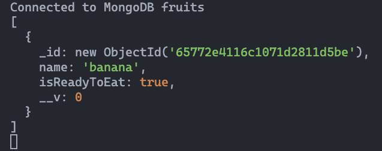

# 

**Learning objective:** By the end of this lesson, students will be able to build an express route that will find and render all of the fruits that have been created in the database.

## The `index` route

The purpose of this route is to provide users with a list of all fruits that have been created in our database. In keeping with RESTful routing conventions, the `url` for this route will be: `/fruits`.

## Create the route

Let's start by defining the route and testing it as soon as possible. Add the following code to `server.js`, beneath the landing page route we've already created and above the `/fruits/new` route. This will place our newly created `/fruits` route still above `app.listen()` (remember, all routes should be defined above `app.listen()`).

```js
// GET /fruits
app.get("/fruits", (req, res) => {
  res.send("This route sends the user to the index page!");
});
```

Test it out by visiting [localhost:3000/fruits](http://localhost:3000/fruits) directly. If all goes well you should see the following in the browser:


## Retrieve the data (fruits)

Now that we know our route is set up, our next step would be to retrieve the data we are looking for in the database. In this case, we are looking for all of the fruits. To do this, we will use the `.find()` method. When using `.find()` without supplying any arguments, it will return an array of all documents in the collection.

Let's now use `.find()` inside our `app.get()`:

```js
app.get("/fruits", async (req, res) => {
  const foundFruits = await Fruit.find();
  res.send("This route sends the user to the index page!");
});
```

Notice also that since we will have to wait for the return value of `.find()` to be assigned to a variable, we have changed the callback function to an **_async_** function and made use of **_await_** in the variable assignment.

To be sure we have the data we are looking for, let's log `foundFruits` to the console:

```js
app.get("/fruits", async (req, res) => {
  const foundFruits = await Fruit.find();
  console.log(foundFruits);
  res.send("This route sends the user to the index page!");
});
```

If we created a single banana document in our database, now when we navigate to [localhost:3000/fruits](http://localhost:3000/fruits) the return value logged to the console should be an array with a single element:



## Update the route

Now that we have the data, we need our next step is to render that data back to the user. Currently our callback function is responding with `.send()` and the user is seeing this:


We are going to want to change `.send()` to `.render()` so that we can create and render a view with **_dynamic_** HTML back to the user. When we refer to **_dynamic_** HTML, we mean HTML that is generated based on data. As you'll see, the EJS template we're going to create will be populated with the data from the database when we render it as a response to the browser.

We'll be passing in two arguments to `.render()`. The first argument will be a **_string_** for the template we will be rendering (`'fruits/index.ejs'`) and the second argument will be an object with the data we want to pass to that template (`foundFruits`) as a property (key/value pair).

We can also remove the `console.log(foundFruits)` since we already know we have the data we want:

```js
app.get("/fruits", async (req, res) => {
  const foundFruits = await Fruit.find();
  res.render("fruits/index.ejs", { fruits: foundFruits });
});
```

If we navigate to [localhost:3000/fruits](http://localhost:3000/fruits) now, we won't be seeing our fruits array. We'll actually be seeing an error!


There will be some additional details, but this is the main part of the error we need to focus on. It is actually a _good_ thing! It tells us what our next step should be, just in case we weren't sure. We're trying to render a view named `index.ejs` in the `views/fruits` directory, _but_ one doesn't exist yet. Let's create that view in our next step!

## Create the `index` template

Now that the route is set up, let's create the template we want this route to render for the user with our list of fruits from the database. We will be putting the `index` template inside the `fruits` sub-folder within the `views` directory we already created:

```bash
touch views/fruits/index.ejs
```

Inside this template file, add the HTML boilerplate, update the `<title>`, and add an `<h1>` inside the `<body>` to get started:

```html
<!DOCTYPE html>
<html lang="en">
  <head>
    <meta charset="UTF-8" />
    <meta name="viewport" content="width=device-width, initial-scale=1.0" />
    <title>Fruits Index</title>
  </head>
  <body>
    <h1>Here Are All the Fruits</h1>
  </body>
</html>
```

Now if we do a refresh or navigate to [localhost:3000/fruits](http://localhost:3000/fruits) that should solve our error and render the `<h1>`.


Let's finally render all of our fruits. In our last step, we passed an object as the second argument to `res.render()`. When we do this, the keys of the object become variables in our EJS file and the values of the object become the values of the corresponding variables in the EJS file. We passed the object `{ fruits: foundFruits }` into `res.render()`, so that means in the EJS file, we'll have access to a variable called `fruits` whose value is the `foundFruits` array coming from our database.

To render each fruit, we will have to iterate over that `fruits` array in our EJS file. Because we are going to render elements in an array, a good option would be to use an unordered list `<ul>`. We'll use the `.forEach()` method to iterate over the elements in the array and then render each object's `name` in an `<li>`. Add the following code into the body of our HTML:

```html
<body>
  <ul>
    <% fruits.forEach(fruit => { %>
    <li><%= fruit.name %></li>
    <% }) %>
  </ul>
</body>
```

Another refresh or navigation to [localhost:3000/fruits](http://localhost:3000/fruits) and we should see our list!


🎉 **Congrats on implementing our app's `index` functionality!** 🎉

[tktk Starter Code](https://git.generalassemb.ly/modular-curriculum-all-courses/building-a-crud-app-with-mongoose-express-and-ejs-fruits-solution/tree/build-the-fruits-index-page-start)

[tktk Complete Code](https://git.generalassemb.ly/modular-curriculum-all-courses/building-a-crud-app-with-mongoose-express-and-ejs-fruits-solution/tree/build-the-fruits-index-page-complete)
