# 

**Learning objective:** By the end of this lesson, students will be able to build an express route that will find and render a single fruit from the database.

## The `show` route

The purpose of this route is to allow users to select a single item, a fruit in our case, to render HTML specific to that item which can and usually will contain more detailed information about said item. In keeping with RESTful routing conventions, the `url` for this route will be: `/fruits/:id`.

Because `:id` is just a placeholder (a url parameter), we can be more specific in the case of this app and go with `:fruitId`.

So, the final route we will be using is `/fruits/:fruitId`.

## Create the UI

Now that we know the route we will be using, we can create the UI which will allow the user to navigate to our individual fruits. A great place to utilize this is the app's `index` page, as it will already display a list of **ALL** of our fruits from the database already.

We will just need to refactor the code to make each of those fruits listed on the `index` page clickable.

Let's review what we already have in the `<body>` of our `views/fruits/index.ejs` file:

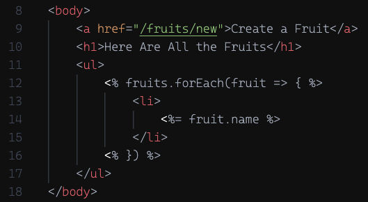

Analyzing what we have here, we are iterating over an array of fruit elements and creating an `<li>` for each of those elements inside of the `<ul>`.

Since the `.forEach()` is already creating each of the individual `<li>`s, we can turn them into links by enclosing their content within `<a>` tags.

**NOTE:** we don't want to enclose the whole `<li>` in an `<a>`.  We can just enclose the `<%= fruit.name %>` within the `<a>` tag, like this:

```html
<a><%= fruit.name %></a>
```

Or to make it even more readable:

```html
<a>
    <%= fruit.name %>
</a>
```

It wouldn't be awful if the `<a>` tag enclosed the `<li>`, but it's not great.  What if we wanted to add content to the `<li>` later on that we didn't want to be clickable?  If the `<li>` was inside an `<a>` everything would be clickable, and we wouldn't be able to do that.

Now we have the content, but what about the value of the `href`?

Well, we know from our first step above that our route is going to be `/fruits/:fruitId`. So how do we access the `id` of each specific fruit? Because if I want to see the banana we created, we will need to go to `/fruits/<the id of the banana>`.

We already have access to each `id`. As we iterate through the fruit objects and render them, we already access their names using `fruit.name`, so we can just do the same for its `id`. Looking back at the element when we logged it to the console, we saw:

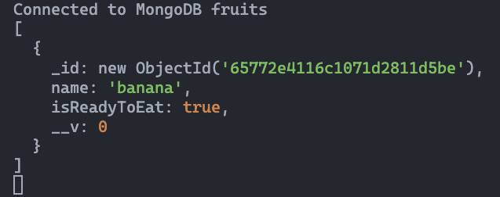

Utilizing `_id` will give us the `id` that we need. Now we can make the adjustment to the `<a>` tag and add the correct `href`.

```html
<a href="/fruits/<%= fruit._id %>">
    <%= fruit.name %>
</a>
```

Once we've updated our HTML, we should see the items showing up as links now:

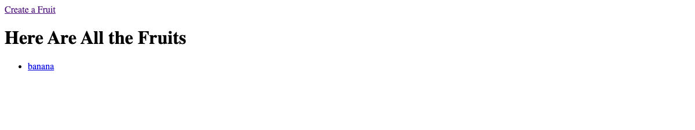

Great, the UI is done! Let's try the link.

Uh-oh! Error!

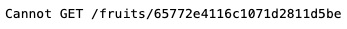

That's no big deal for us at this point. We should know that this error tells us that this particular route does not exist. Makes sense, we haven't created it yet. Let's do that next...

## Create the `show` route

Let's define the route and test it as soon as possible.

> 🚨 The placement of this route **MUST** be precise!

We're going to add the following code to `server.js`:

```js
app.get('/fruits/:fruitId', (req, res) => {
    res.send(`This route sends the user to the show page for the fruit with id: ${req.params.fruitId}!`);
})
```

As always, this route must be above `app.listen()` (remember, all routes MUST be defined above `app.listen()`).

This code **MUST** be **BELOW** the `/fruits/new` route.

Having said that, what if we don't...

### ❗️ `/fruits/:fruitId` placed **ABOVE** `/fruits/new`

So what happens if we don't place this route **BELOW** `/fruits/new`? Let's try it...

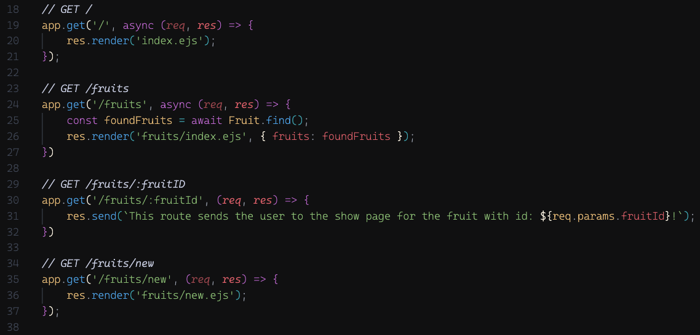

Now try navigating to the form to create a new fruit. Wha...? What happened?

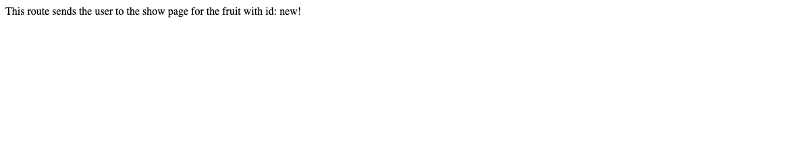

Well, nothing really went wrong. Let's analyze this deeper.

The path in the address bar showed that we did indeed navigate to `/fruits/new`. As requests come in, they will look for a match in `server.js` starting at the top and then working their way down one at a time.

So `/fruits/new` obviously does not match `/`.

Next...

Nor does `/fruits/new` match `/fruits`.

Next...

Oh, `/fruits/new` actually does match `/fruits/:fruitId`. When there is a parameter in the route expecting a value, it doesn't care what its type is. If you remember, all url parameters receive the value as a string. Because there is a value in the path (`new`) following `/fruits/`, the parameter `:fruitId` takes on the value of `new`.

The proof of this is in the browser itself. Remember what we're `res.send()`ing to the browser is:

```js
res.send(`This route sends the user to the show page for the fruit with id: ${req.params.fruitId}!`);
```

The value of `req.params.fruitId` is `'new'` as we can see in the browser:


The path has now matched a route so the request ends, and it will never make it past `/fruits/:fruitId` to get to `/fruits/new`.

So, that's why `/fruits/:fruitId` **MUST** be **BELOW** `/fruits/new`!

### ✅ `/fruits/:fruitId` placed **BELOW** `/fruits/new`

Let's properly place `/fruits/:fruitId` **BELOW** `/fruits/new`:

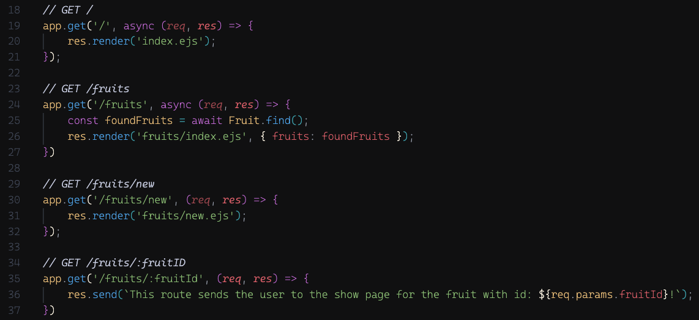

That's better. Refresh and check the functionality of the link to our new fruits form. Should be back to normal now.

Now check the link to an individual fruit. Woohoo! There's the `_id` which matches what we see in the address bar.

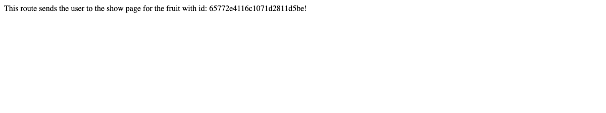

## Retrieve the data (individual fruit)

Now that we know our route is set up, our next step would be to retrieve the data we are looking for in the database. In this case, we are looking for a specific fruit using its `_id`.

To do this, we are going to query the database using a different method than the one we used to find all fruits. In this case, we will use the `.findById()` method passing in the `_id` as its argument. When using `.findById()` it will return a document based on it's `_id`.

Let's now use `.findById()` inside our `app.get()`:

```js
app.get('/fruits/:fruitId', async (req, res) => {
    const foundFruit = await Fruit.findById(req.params.fruitId);
    res.send(`This route sends the user to the show page for the fruit with id: ${req.params.fruitId}!`);
})
```

Notice also that since we will have to wait for the return value of `.findById()` to be assigned to a variable, we have changed the callback function to an ***async*** function and made use of ***await*** in the variable assignment.

To be sure we have the data we are looking for, let's log `foundFruit` to the console:

```js
app.get('/fruits/:fruitId', async (req, res) => {
    const foundFruit = await Fruit.findById(req.params.fruitId);
    console.log(foundFruit);
    res.send(`This route sends the user to the show page for the fruit with id: ${req.params.fruitId}!`);
})
```

If we created a single banana document in our database, when we click on the link to that fruit in the index page, the return value logged to the console should be that document:

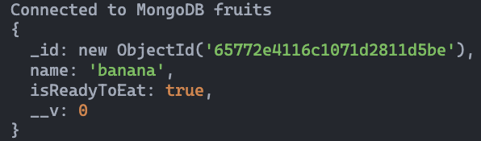

## Update the route

Now that we have the data we need, our next step is to render that data back to the user. Currently our callback function is responding with `res.send()`.

We are going to want to update this to a `res.render()` so that we can create and render a view with ***dynamic*** HTML back to the user.

We'll be passing in two arguments to `res.render()`. The first argument will be a ***string*** for the template we will be rendering (`'fruits/show.ejs'`) and the second argument will be an object with the data we want to pass to that template (`foundFruit`) as a property (key/value pair).

We can also remove the `console.log(foundFruit)` since we already know we have the data we want:

```js
app.get('/fruits/:fruitId', async (req, res) => {
    const foundFruit = await Fruit.findById(req.params.fruitId);
    res.render('fruits/show.ejs', { fruit: foundFruit });
})
```

If we click on the link to that fruit now, we won't be seeing that fruit. We'll actually be seeing an error again!


Again, there will be some additional details but this is the main part of the error we need to focus on. Remember, it is actually a *good* thing! It tells us what our next step should be, just in case we forgot. We're trying to render a view named `show.ejs` in the `views/fruits` directory, *but* one doesn't exist yet. Let's create that view in our next step!

## Create the `show` template

Now that the route is set up, let's create the template we want this route to render. We will be putting the `show` template inside the `fruits` sub-folder within the `views` directory we already created:

```bash
touch views/fruits/show.ejs
```

Inside this template file, add the HTML boilerplate, update the `<title>`, and add an `<h1>` inside the `<body>` to get started:

```html
<!DOCTYPE html>
<html lang="en">
<head>
  <meta charset="UTF-8">
  <meta name="viewport" content="width=device-width, initial-scale=1.0">
  <title>Fruit Show Page</title>
</head>
<body>
  <h1>Here Is Your Chosen Fruit</h1>
</body>
</html>
```

Now, if we do a refresh or click on a specific fruit on our `index` page, that should solve our error and render the `<h1>`.


This is an exceptionally generic show page for a specific fruit. Remember how the 2nd parameter that we passed `res.render` was `{ fruit: foundFruit }`?  Well, that means that our EJS file will have a variable named `fruit` whose value will be the `foundFruit` variable in our route.  *That* `foundFruit` variable is the data that came back MongoDB regarding the individual fruit we were searching for.  The result of all this is that we can now access properties of the specific fruit in our EJS file like so:

```html
<!DOCTYPE html>
<html lang="en">
    <head>
        <meta charset="UTF-8">
  <meta name="viewport" content="width=device-width, initial-scale=1.0">
  <title><%= fruit.name %></title>
</head>
<body>
    <h1>Here are the details about <%= fruit.name %></h1>
</body>
</html>
```

Refresh or click on a specific fruit on our `index` page, and our `show` page should be more specific:

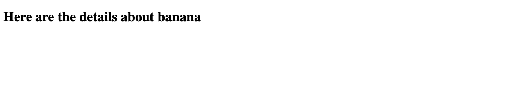

Now I know what fruit details I should be seeing, but I don't see the actual details yet, specifically if the fruit is ready to eat or not.

Let's take care of that step next.

Using some control flow based on the value of `fruit.isReadyToEat`, we can decide what we should be rendering. Adding this `if/else` statement after the `<h1>` should do the job:

```html
<body>
    <h1>Here are the details about <%= fruit.name %></h1>
    <% if (fruit.isReadyToEat) { %>
        <p>This fruit is ready to eat!</p>
    <% } else { %>
        <p>This fruit is not ready to eat!</p>
    <% } %>
</body>
```

Refresh or click on a specific fruit on our `index` page, and our `show` page should now show the details of that fruit (can we eat it or not!).

> ❗️ If you've only been working with a single fruit in your database up until this point, be sure to add more and test each link on the `index` page.

Before moving on, let's keep up with the great UX we started last lesson...

## Link `show` page back to fruits `index` page

Now that we've managed to navigate to a specific fruit, let's say we want to look at the details of another fruit. We'll need to navigate back to the `index` page.

### 💪 YOU DO:

For this link, let's copy the approach we used on our `new` page. Because this is more of a `back` *'button'* so to speak, we don't really want it in our usual nav bar location at the top. Like we did on the `new` page, place the link at the bottom of the `<body>`, right after the `if/else`.

Once again, add the correct `href` to the opening tag and some content (`'Back to Fruits Index'` perhaps) and you should have no problem reproducing the following:

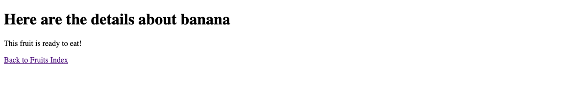

Don't forget to test it!

🎉 **Congrats on implementing our app's `show` functionality!** 🎉

[tktk Starter Code](https://git.generalassemb.ly/modular-curriculum-all-courses/building-a-crud-app-with-mongoose-express-and-ejs-fruits-solution/tree/build-the-fruits-show-page-start)

[tktk Complete Code](https://git.generalassemb.ly/modular-curriculum-all-courses/building-a-crud-app-with-mongoose-express-and-ejs-fruits-solution/tree/build-the-fruits-show-page-complete)
