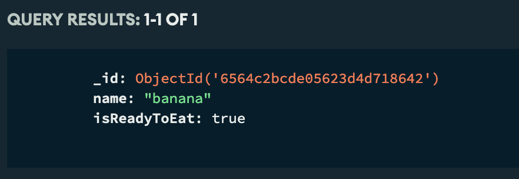

# 

**Learning objective:** By the end of this lesson, students will be able to create a route that will receive the submission of the form in `/fruits/new`.  This route will create a fruit document in the `fruits` collection in their MongoDB Atlas database.

## The CREATE Route

The purpose of this route is to insert the data that is sent along with the form submission from the new fruits page into our MongoDB database.  In keeping with RESTful routes conventions, the url for this route will be: `/fruits`.  The HTTP method associated with this route is `POST`.  Remember that a `POST` HTTP method implies creating data, which is why this method is a good choice for this route.  By looking at the just the path (`/fruits`) and the HTTP method (`POST`), we can quickly determine that this route creates fruits.

Remember that the user will be submitting a form (as opposed to clicking a link) in `/fruits/new` to get this route.  When this form submission happens, the browser will make a request to the url/method specified, including any form data in the body of the request.  Unfortunately, express doesn't easily allow us to access this data.  Because of this, we will need to add some middleware that will allow us to access the form data in the request's body. In our `server.js` file let's add the following middleware beneath the line of code that brings in our Fruit model.

```javascript
app.use(express.urlencoded({ extended: false }));
```

Remember, `app.use` allows us to plug additional functionality into express.  It basically extends the capabilities of our app.  Here, we plug in `express.urlencoded`, which looks for form data in the body of any requests that come in.  If it finds any, it creates a JS object representation of the form data submitted.  It then creates a new property on the `req` param of any routes that match the incoming request called `body`.  Finally it assigns the JS object representing the form data to `req.body`.  We now are able to use `req.body` to see what data the user entered when they submit the form on the `/fruits/new` page.

## Create the route

Let's start by defining the route and testing it as soon as possible. Add the following code to `server.js`, beneath the new page route we've already created and above the `app.listen()` method (remember, all routes should be defined above `app.listen()`).

```javascript
// server.js

// POST /fruits
app.post('/fruits', async (req, res) => {
  console.log(req.body);
  res.redirect('/fruits/new');
});
```

Resubmit the form in `/fruits/new`.  You'll instantly be redirected back to `/fruits/new`, but if you check your terminal, you should see a JS object representation of the form data.

## Build our create function in our post route

Now that we can confirm our form submits its data to the route we have scaffolded, let's add the logic that will allow us to create a fruit once this route is hit:

```javascript
// server.js

// POST /fruits
app.post('/fruits', async (req, res) => {
  if (req.body.isReadyToEat === 'on') {
    req.body.isReadyToEat = true;
  } else {
    req.body.isReadyToEat = false;
  }
  await Fruit.create(req.body);
  res.redirect('/fruits/new');
});
```

In the above code snippet, we are using a conditional to add a boolean value to `req.body.isReadyToEat`.  If the user checked the "Ready to Eat?" checkbox, `req.body.isReadyToEat` will be set to the string 'on'.  It's a little confusing why `req.body.isReadyToEat` would be set to 'on', but basically it has to do with how browsers deal with checkboxes.  There's not much we can do to change how the data comes in initially, but we can reset that value to `true` before sending it to the Mongo database.  If the user didn't check the "Ready to Eat?" checkbox, `req.body.isReadyToEat` will be undefined.  Again this has to do with how the browser handles checkbox.  In any case, if `req.body.isReadyToEat` isn't set to the string 'on', we will set it to false.  As annoying as this is, it's a good lesson.  Your form data might not always match what's in your model, and sometimes you'll need to mess with it a little to get the two to align.

After that we will send the contents of the form (`req.body`) over to our database via the `.create()` method on the `Fruit` model. Once that fruit is successfully created, we will respond with a redirect to `/fruits/new`.

Let us test that our method works by navigating to our MongoDB Atlas dashboard for the fruits database.  While on the dashboard for MongoDB Atlas, click on the "Collections" section for your database.


Once you can see the collections for your database, find the database that corresponds to this fruits app and click on it.  You should see a collection called "fruits".  Click on that collection and see if you can find the document of your newly created fruit.



If you can see your newly created fruit you have successfully created a new fruit from your rendered form.  Congrats!!!


[tktk Starter Code](https://git.generalassemb.ly/modular-curriculum-all-courses/building-a-crud-app-with-mongoose-express-and-ejs-fruits-solution/tree/create-a-fruit-start)

[tktk Complete Code](https://git.generalassemb.ly/modular-curriculum-all-courses/building-a-crud-app-with-mongoose-express-and-ejs-fruits-solution/tree/create-a-fruit-complete)
