# 

**Learning objective:** By the end of this lesson, students will be able to make minor refactors to the app by adding links to connect existing pages using valid routes, thereby improving the app's UX.

## Add navigation to our application

Up until this point in our application whenever we want to navigate to a different page, we've had to type the correct path in the address bar.

This makes for a very poor user experience. How does the user even know what pages we've created and are available to them?

We can fix this easily by adding links (`<a>`) to our existing valid routes.

## Link landing page to `index` page

Let's start with our **landing page** located at the root route (`'/'`). You can also get there quickly by clicking [localhost:3000](http://localhost:3000). See how easy links make everything!

We should see the following:

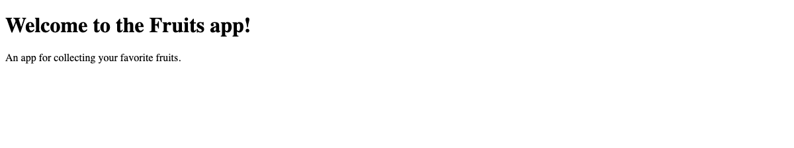

Now let's take a look at our HTML in `views/index.ejs`:

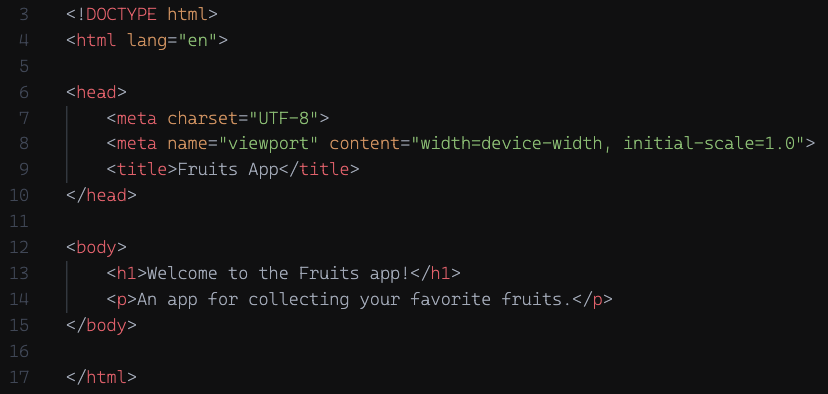

Inside the body, at the very top, above the `<h1>`, let's add an `<a>` tag. We'll also need to add the following to the new `<a>` tag:

- The `href` value. To get to the `index` page, we'll need to enter its route as the value of the `href`, which is `/fruits`.
- Some content between the opening and closing tags so that users will have something visible to click, say `'Fruits Index`.

That will give us the following line to enter into our HTML:

```html
<a href="/fruits">Fruits Index</a>
```

After adding the code above, the body of our HTML in `views/index.ejs` should look like this:

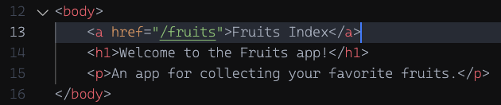

Now if we take a look in the browser, we should see a **_VERY_** simple nav bar.

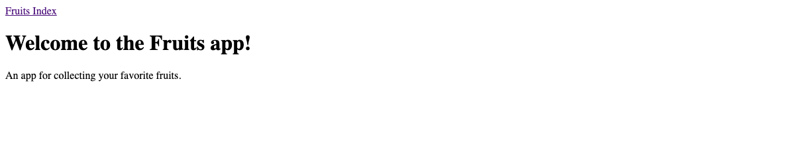

Tada! Now test it out! It should take you to our `index` page. Great work! Now let's add a few more...

## Link `index` page to `new` page with new fruits form

Let's follow the same steps as above to add a link in the `index` page that will take us to our `new` page.

Here is our `index` page currently:

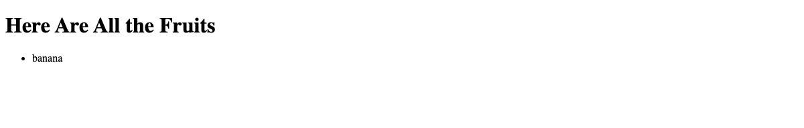

And our HTML in `views/fruits/index.ejs`:

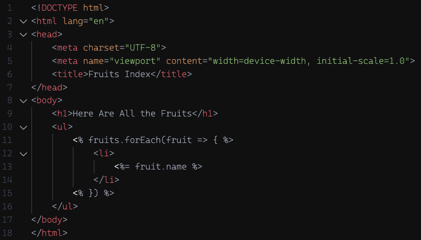

We will add a new `<a>` tag to the top of the `<body>` just as we did above. Don't forget to add the correct `href` to the opening tag and also content (`'Create a Fruit'` sounds pretty good).

After adding the new link, the `<body>` should now look like this:

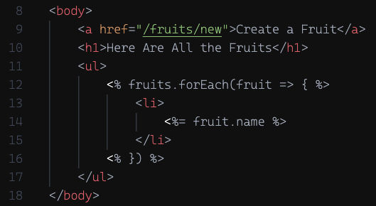

Taking a look at the fruits `index` page now, we should see that same type of **VERY** simple nav bar:

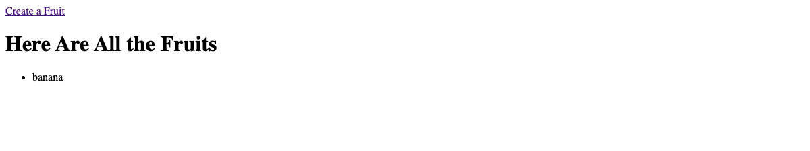

You know what to do next: test it out! Two down!

## Link `new` page with form back to fruits `index` page

Now that the user has navigated to our form to create a new fruit, let's say they've changed their minds. Or they want to check the list again before adding a new fruit. Whatever the reason, let's say they need to navigate back to the `index` page.

### 💪 YOU DO:

For this link, we'll change up its placement. Because this is more of a `back` _'button'_ so to speak, we don't really want it in our usual nav bar location at the top. This time we will place the link at the bottom of the `<body>`, right after the `<form>`.

Once again, add the correct `href` to the opening tag and some content (`'Back to Fruits Index'` perhaps) and you should have no problem reproducing the following:

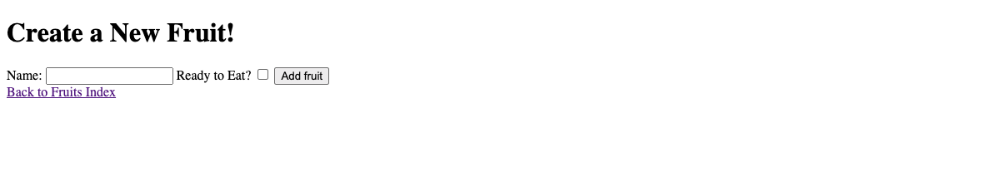

Don't forget to test it!

🎉 Congrats on finishing those links! We no longer need to manually navigate around this app! 🎉

### Whoops! Spoke too soon...

## Refactor the **_`create`_** Action's Redirect

One more thing we can do to make our app even more user friendly is to update `res.redirect()` after creating a new fruit in our `app.post('/fruits')` callback function.

If we look at what we have currently, we are redirecting right back to the form to create a new fruit:

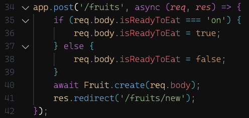

It would probably be much more useful to the user to see their newly created fruit added to the list.

We can accomplish this by changing the path in `res.redirect()`. Currently the argument being passed in is the string `'/fruits/new'`. To see our new fruit added to the list after clicking the **'submit'** button, we can update the string by removing `/new`. Now if we pass in just `'/fruits'` to `res.redirect()` it will render the `index` view.

Our new redirect should be added as follows: `res.redirect('/fruits')`:

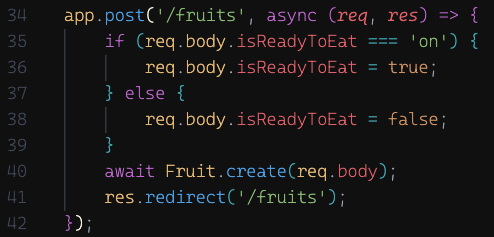

Congrats on refactoring the redirect! 🎉

### Now were done!

[tktk Starter Code](https://git.generalassemb.ly/modular-curriculum-all-courses/building-a-crud-app-with-mongoose-express-and-ejs-fruits-solution/tree/improving-the-user-experience-start)

[tktk Complete Code](https://git.generalassemb.ly/modular-curriculum-all-courses/building-a-crud-app-with-mongoose-express-and-ejs-fruits-solution/tree/improving-the-user-experience-complete)
